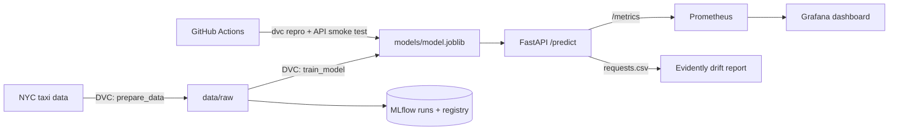
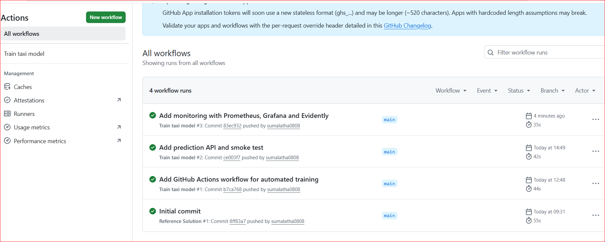
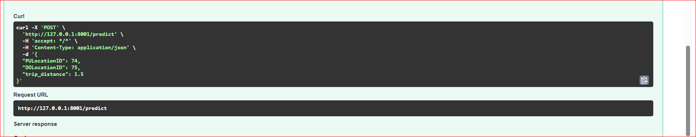
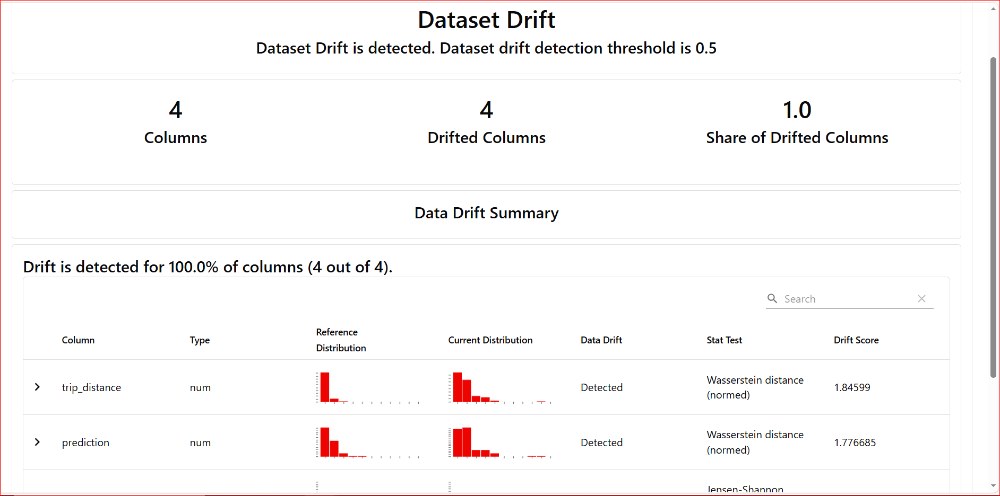

# NYC Green Taxi – End-to-End MLOps Pipeline

A small but complete MLOps workflow around a taxi ride duration model: from reproducible training to an API, automated retraining in CI, and monitoring of both the system and the model.

The focus is not a complex model, but a full path from **training → deployment → monitoring** that is reproducible, automated and easy to inspect.

## What it does

- **Trains** a linear regression model that predicts ride duration (minutes) for NYC green taxi trips, January 2024.
- **Versions** data and model with **DVC**, and tracks every run in **MLflow** (parameters, metrics, model registry with a `production` alias).
- **Retrains automatically** with **GitHub Actions** on every code change, on demand, and every Monday.
- **Serves** predictions through a **FastAPI** service.
- **Monitors** the API with **Prometheus** and **Grafana**, and detects data drift with **Evidently**.

**Model scope:** `trip_distance` is the taximeter distance, which is only known *after* a trip ends. The model therefore replays completed trips; it is not a pickup-time estimate.

## Architecture



## Results

| Metric | Value |
|---|---|
| Test RMSE | **5.07 minutes** |
| Training trips | 41,908 |
| Test trips | 10,478 |

Example: a 1.5-mile trip from zone 74 to zone 75 is predicted at about **9.8 minutes**.

## Tech stack

Python 3.13 · uv · scikit-learn · DVC · MLflow · FastAPI · Docker Compose · Prometheus · Grafana · Evidently · GitHub Actions

## Quick start

Requirements: [uv](https://docs.astral.sh/uv/) and Docker Desktop.

```bash
# 1. Install dependencies
uv sync

# 2. Download data and train the model (DVC pipeline)
uv run dvc repro
uv run dvc metrics show

# 3. Check the API without starting a server
uv run python -m src.check_api

# 4. Start the API, Prometheus and Grafana
docker compose up --build -d
```

| Service | URL |
|---|---|
| API docs | http://127.0.0.1:8000/docs |
| Prometheus | http://127.0.0.1:9090 |
| Grafana (admin / admin) | http://127.0.0.1:3000 |
| MLflow UI (`uv run mlflow ui`) | http://127.0.0.1:5000 |

Example request:

```bash
curl -X POST http://127.0.0.1:8000/predict \
  -H "Content-Type: application/json" \
  -d '{"PULocationID": 74, "DOLocationID": 75, "trip_distance": 1.5}'
```

Response:

```json
{"predicted_duration_minutes": 9.81}
```

## Pipeline steps

### 1. Training code
The notebook logic is refactored into reusable modules: `prepare_data.py` downloads the data, `preprocess.py` cleans it (duration 1–60 min, distance 0.1–100 miles, location IDs as categories), and `train.py` trains, evaluates and saves the model to `models/model.joblib` with metrics in `reports/train_metrics.json`.

### 2. Data and experiment tracking
`dvc.yaml` defines two stages (`prepare_data` → `train_model`). `dvc.lock` records the exact data, code and model versions. Each training run is logged to MLflow and registered as `green-taxi-ride-duration` with the alias `production`.

### 3. Automated retraining
`.github/workflows/train.yaml` installs locked dependencies (`uv sync --locked`), runs `dvc repro`, shows the metrics, smoke-tests the API, and uploads the model, metrics and MLflow run as an artifact. It runs on push, manually, and on a weekly schedule.



### 4. Prediction API
`src/api.py` loads the model on startup and exposes `/health`, `/predict` (validated input schema; invalid input returns HTTP 422) and `/metrics`.



### 5. Monitoring
- **System behaviour:** request count, errors and prediction latency (p95) in Prometheus.
- **Model behaviour:** distribution of predicted durations as a Prometheus histogram.
- **Data drift:** every request is logged and compared with the training data in an Evidently report.


## Drift experiment

To test the monitoring, I sent two batches of 200 real trips to the API:

```bash
uv run python src/send_sample_requests.py                 # normal batch
uv run python src/generate_report.py --name normal_report

Remove-Item monitoring/requests.csv                       # start a fresh log
uv run python src/send_sample_requests.py --shifted       # trip_distance x 3
uv run python src/generate_report.py --name shifted_report
```

In the shifted batch, Evidently detected strong drift in **trip_distance** (Wasserstein distance 1.85) and, as a consequence, in the model's **prediction** (1.78). This is the expected chain: when inputs change, the predictions move with them. The location IDs were also flagged; with only 200 requests spread over many taxi zones, categorical drift tests are sensitive to small samples, so a larger batch would be needed before acting on that signal.

In production, a drift result like this would be a trigger to investigate the data and retrain the model.



## Project structure

```text
.
├── .github/workflows/train.yaml   # CI: retraining + API smoke test
├── src/
│   ├── prepare_data.py            # download raw data
│   ├── preprocess.py              # cleaning and features
│   ├── train.py                   # training, MLflow logging, registry
│   ├── api.py                     # FastAPI service with Prometheus metrics
│   ├── check_api.py               # API smoke test
│   ├── send_sample_requests.py    # normal / shifted request batches
│   └── generate_report.py         # Evidently drift report
├── monitoring/                    # Prometheus and Grafana configuration
├── dvc.yaml / dvc.lock            # reproducible pipeline
├── Dockerfile / docker-compose.yaml
└── pyproject.toml / uv.lock
```

