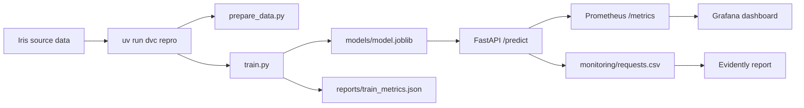

# Reference Solution

This folder contains a small reference solution for the MLOps project. It uses scikit-learn's built-in Iris dataset to illustrate the workflow; the project assignment uses the taxi notebook at [../01-train-ml-model.ipynb](../01-train-ml-model.ipynb).

## Learning Path

If you are reading this solution to understand the project end to end, follow this order:

1. Run `uv run --directory solution dvc repro` to build the dataset and train the model.
2. Inspect `src/train.py` and `reports/train_metrics.json` to connect code to metrics.
3. Run the API and send a few prediction requests.
4. Open Prometheus and Grafana to inspect operational metrics.
5. Generate the Evidently report to compare request data with reference data.



## Folder Layout

```text
solution/
├── .dvc/
├── data/
├── models/
├── monitoring/
├── reports/
├── src/
├── docker-compose.yaml
├── dvc.yaml
└── Dockerfile
```

## Setup

Follow the repository [setup instructions](../README.md#setup) first. The solution uses Python 3.13 and the root [pyproject.toml](../pyproject.toml) and [uv.lock](../uv.lock); it does not need a second environment or dependency file.

Run every command below from the **repository root**, not from `solution/`. `uv run --directory solution` changes the working directory for that command while reusing the root `.venv/`.

## Run the Full Flow

### 1. Prepare the data and train the model

```bash
uv run --directory solution dvc repro
```

This command:

- creates `data/raw/iris.csv`,
- trains the model,
- writes `models/model.joblib`,
- stores metrics in `reports/train_metrics.json`,
- logs artifacts and metrics to the local MLflow tracking files inside `mlflow.db` and `mlartifacts/`.

### 2. Start the API

```bash
uv run --directory solution uvicorn src.api:app --reload --port 8000
```

Open these endpoints:

- API docs: <http://127.0.0.1:8000/docs>
- Health check: <http://127.0.0.1:8000/health>
- Prometheus metrics: <http://127.0.0.1:8000/metrics>

### 3. Send a sample prediction request

```bash
curl -X POST http://127.0.0.1:8000/predict \
  -H "Content-Type: application/json" \
  -d '{
    "sepal_length_cm": 5.1,
    "sepal_width_cm": 3.5,
    "petal_length_cm": 1.4,
    "petal_width_cm": 0.2
  }'
```

Each request is appended to `monitoring/requests.csv`. This file is later used by the Evidently report.

Measurements must be positive, finite numbers. Invalid requests return HTTP 422 without entering the prediction log.

### 4. Start Prometheus and Grafana

Stop the local API with `Ctrl + C` before starting the full stack: Docker also uses port 8000. Run Compose from the repository root:

```bash
docker compose -f solution/docker-compose.yaml up --build -d
```

Open:

- Prometheus: <http://127.0.0.1:9090>
- Grafana: <http://127.0.0.1:3000>

Default Grafana credentials:

- username: `admin`
- password: `admin`

The dashboard is provisioned automatically and shows request volume and average latency. Send the sample batch below to populate the container's API metrics and request log.

### 5. Generate an Evidently report

With the API running, send the supplied batch of six requests, two observations per Iris class:

```bash
uv run python solution/src/send_sample_requests.py
```

Then generate the report:

```bash
uv run python solution/src/generate_report.py
```

Open `solution/monitoring/reports/data_drift_report.html` in a browser. It is a static snapshot: rerun the report command after new requests. Grafana refreshes API metrics separately.

The **reference** is the full Iris CSV at `solution/data/raw/iris.csv`, not just the training split. The **current** data contains every successful prediction request in `solution/monitoring/requests.csv`, with no time-window filter. Both are restricted to the four input measurements; labels and predictions are excluded.

| Report element | What to check |
|---|---|
| Dataset summary | Number and share of drifting features. The default dataset drift threshold is 50%, or two of the four features here. |
| Per-feature results | Method, score, threshold, and drift status. Scores are method-specific, not always p-values; see Evidently's [default method selection](https://docs.evidentlyai.com/metrics/preset_data_drift). |
| Distribution plots | Expand a feature to compare reference and current values and investigate the shift. |

Drift is not a measurement of prediction accuracy or an automatic reason to retrain. The log has no ground-truth labels, and the six-request batch only demonstrates the workflow. The script's five-row minimum is not a statistical reliability threshold; interpret results on a larger, representative batch.

## API Smoke Check

After training, run the same check as the reference GitHub Actions workflow:

```bash
uv run --directory solution python -m src.check_api
```

It checks `/health`, a valid prediction, and HTTP 422 for a negative measurement. No server needs to be running, and the check uses a temporary request log so it does not change the monitoring history.

## Cleanup

Stop the Compose stack when you finish:

```bash
docker compose -f solution/docker-compose.yaml down
```

This keeps the locally generated model, request log, and reports for your next run.
